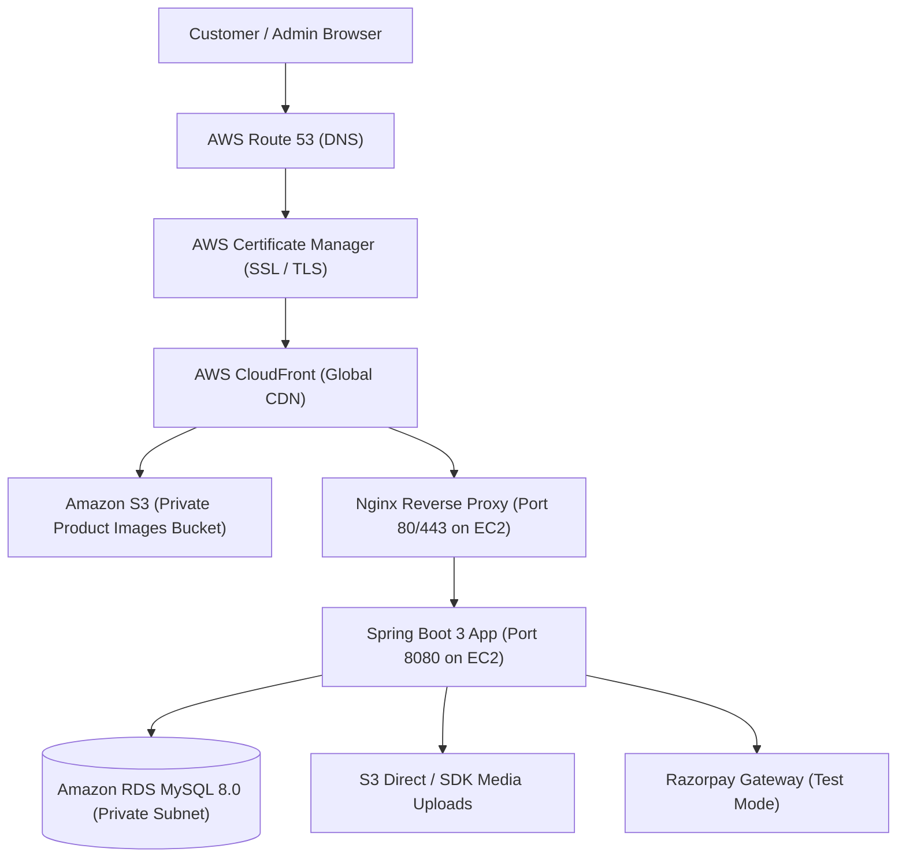

# StyleHub — Complete AWS Cloud Architecture & Deployment Guide

This guide details the complete production deployment of StyleHub on Amazon Web Services (AWS) using **EC2 + RDS MySQL + S3 + CloudFront + Nginx + IAM + Route 53 + ACM**.

---

## 1. Cloud Architecture Overview



### AWS Services Matrix
| AWS Service | Production Purpose |
|---|---|
| **EC2 (Ubuntu 24.04)** | Hosts the Java 21 Spring Boot runnable JAR managed by `systemd`. |
| **Amazon RDS (MySQL 8.0)** | High-availability managed MySQL database storing users, orders, and products. |
| **Amazon S3** | Object storage bucket storing customer & admin product photographs. |
| **Amazon CloudFront** | Low-latency global CDN delivering images and static assets under HTTPS. |
| **IAM** | Least-privilege instance profile granting EC2 access to S3 without hardcoded keys. |
| **Route 53 & ACM** | Custom domain routing and free automatic renewal SSL/TLS certificate. |
| **CloudWatch** | Real-time CPU, RAM, disk, and application log monitoring with alerting. |

---

## 2. Step-by-Step Deployment Procedure

### Step 1: Provision Infrastructure with CloudFormation
Run the provided template via AWS CLI:
```bash
aws cloudformation create-stack \
  --stack-name stylehub-production \
  --template-body file://deployment/aws/cloudformation-template.yaml \
  --parameters ParameterKey=KeyName,ParameterValue=your-key-pair \
               ParameterKey=DBPassword,ParameterValue='YourSecurePassword123!' \
  --capabilities CAPABILITY_IAM
```
Retrieve the outputs:
```bash
aws cloudformation describe-stacks --stack-name stylehub-production --query "Stacks[0].Outputs"
```

---

### Step 2: Build the Application
On your build machine or CI/CD runner:
```bash
mvn clean package -DskipTests
```
The generated artifact is `target/stylehub-1.0.0.jar`.

---

### Step 3: Copy Files to EC2
```bash
scp -i your-key.pem target/stylehub-1.0.0.jar ubuntu@<EC2-PUBLIC-IP>:/home/ubuntu/
scp -i your-key.pem -r deployment ubuntu@<EC2-PUBLIC-IP>:/home/ubuntu/
```

---

### Step 4: Run the Automated Deployment Script on EC2
SSH into the EC2 instance:
```bash
ssh -i your-key.pem ubuntu@<EC2-PUBLIC-IP>
chmod +x deployment/aws/deploy-aws.sh
sudo ./deployment/aws/deploy-aws.sh
```

---

### Step 5: Configure Production Database Connection
Edit `/etc/stylehub.env`:
```bash
sudo nano /etc/stylehub.env
```
Ensure the variables reflect your RDS endpoint:
```ini
SPRING_PROFILES_ACTIVE=prod
PORT=8080
DB_URL=jdbc:mysql://stylehub-mysql.xxxxxx.ap-south-1.rds.amazonaws.com:3306/stylehub?useSSL=true&allowPublicKeyRetrieval=true&serverTimezone=UTC
DB_USERNAME=stylehub_admin
DB_PASSWORD=YourSecurePassword123!
AWS_REGION=ap-south-1
AWS_S3_BUCKET=stylehub-media-xxxxxx
RAZORPAY_KEY_ID=rzp_test_your_key_id
RAZORPAY_KEY_SECRET=your_key_secret
```
Restart the service to apply:
```bash
sudo systemctl restart stylehub
```

---

### Step 6: Enable HTTPS with Let's Encrypt / Certbot
```bash
sudo apt install -y certbot python3-certbot-nginx
sudo certbot --nginx -d yourstore.com -d www.yourstore.com
```

---

## 3. Maintenance, Monitoring & Operations
- **Check application status**: `sudo systemctl status stylehub`
- **View live application logs**: `sudo journalctl -u stylehub -f`
- **Restart application**: `sudo systemctl restart stylehub`
- **Nginx configuration test**: `sudo nginx -t && sudo systemctl reload nginx`
